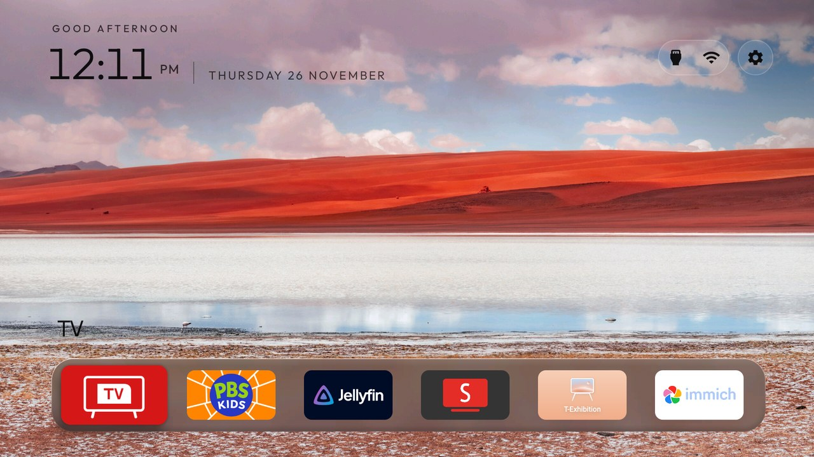
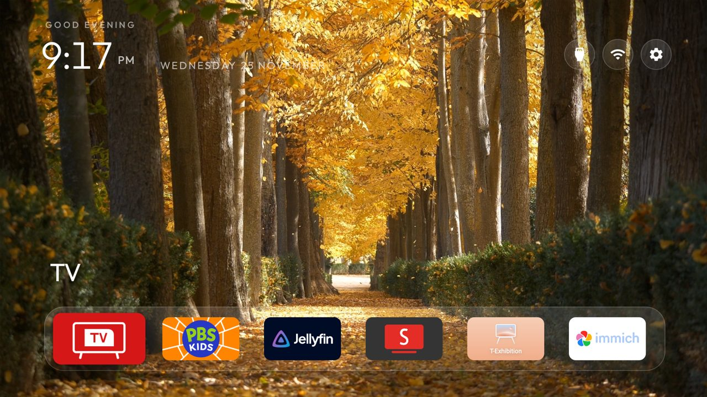
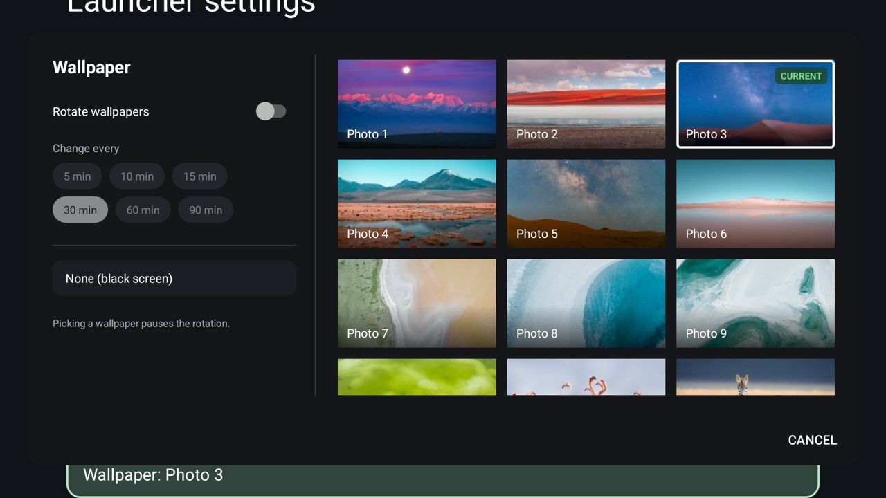
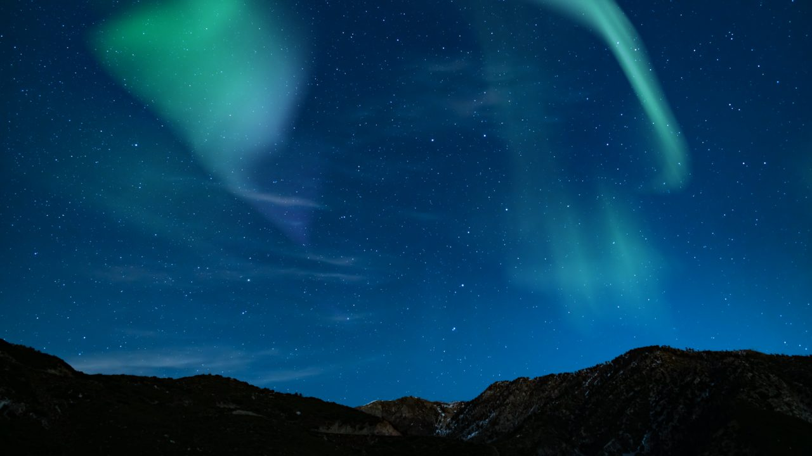
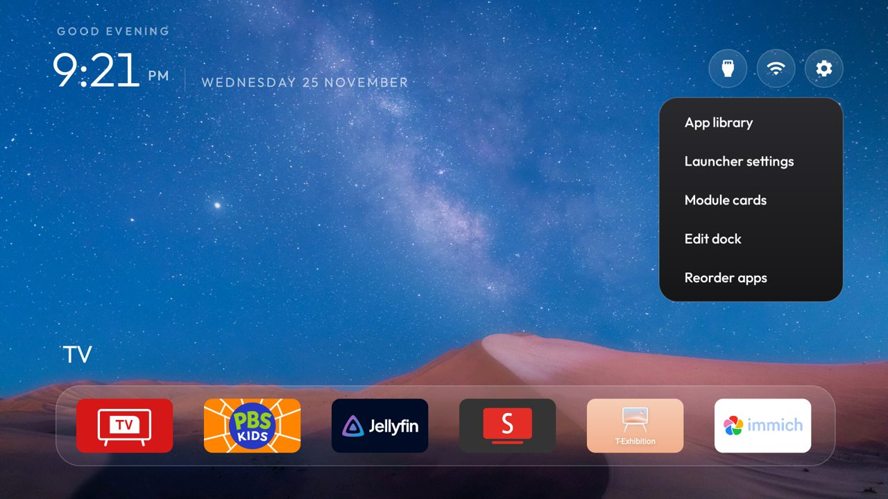
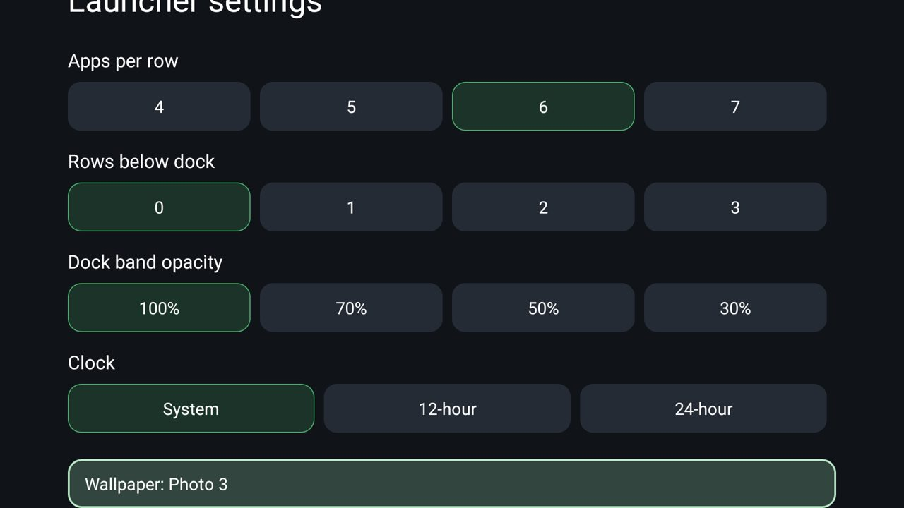
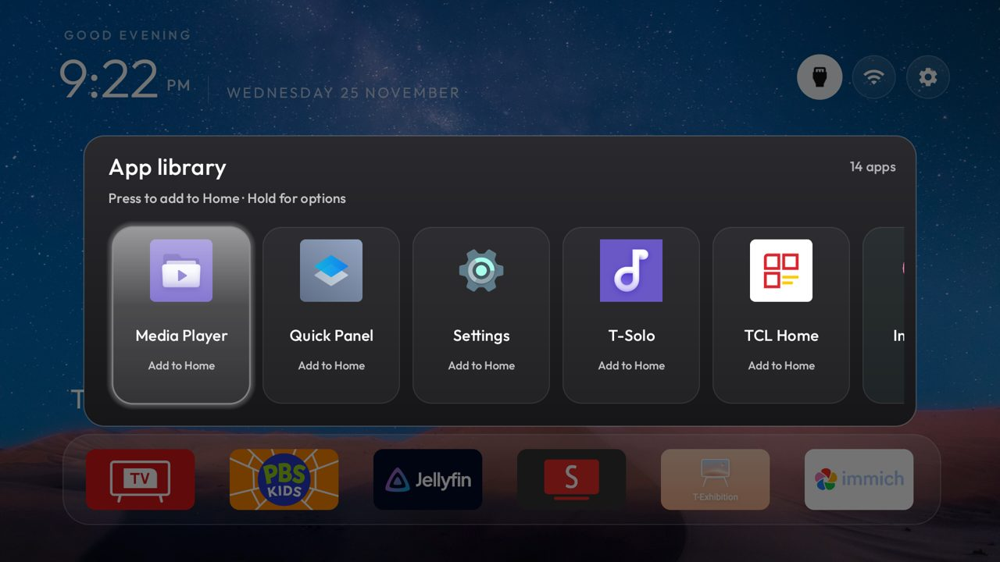

# Clean TV Launcher

A clean, Apple TV-style home screen for Android TV / Google TV: one scrollable
row of apps on a frosted glass band, a big readable clock, and wallpapers —
photos or live videos with sound — that take over the screen when the TV is
idle and put it to sleep when you tell it to.

This is a fork of the launcher in
[Gathin23/cleanyourtv](https://github.com/Gathin23/cleanyourtv), extended and
tuned on a TCL 75QM6K Pro (Google TV, Android 14). The changes over upstream
are listed under [What this fork adds](#what-this-fork-adds). The other half
of the job — the pre-installed apps and telemetry disabled on that TV, and
how to re-enable any of them — is written up in [DEBLOAT.md](DEBLOAT.md).

## Download

Grab the APK from the
[Releases page](https://github.com/dharmapoudel/clean-tv-launcher/releases)
and sideload it. It is the optimized release build (R8-minified); it is
signed with a debug key so it can be installed and updated over ADB without
a private keystore — the key affects installation only, never performance:

```sh
adb connect <tv-ip>
adb install clean-tv-launcher-3.6.apk
```

Then make it your home screen — either run `./build-and-install.sh` from a
source checkout (below), or set it manually and disable the stock launcher.
Building from source works too; see [Build and install](#build-and-install).

**Full walkthrough: [INSTALL.md](INSTALL.md)** — connecting over ADB, the
backup and Wi-Fi checks to run first, setting Home, enabling the key
helper, and how to undo everything.



## Screenshots

| | |
|---|---|
|  |  |
| Home over a live video wallpaper | The wallpaper picker: rotate switch and interval chips in the side rail, equal-size previews, the current pick tagged |
|  |  |
| Idle fade: the UI melts away until only the wallpaper is left | Long-press the Settings pill for the launcher menu (the App library lives here) |
|  |  |
| Launcher settings | The App library: press to add an app to the Home row |

## The home screen

- **One scrollable row** holds every app, dock apps first; the glass band runs
  behind all of them. Focused tiles scale up to 1.20× — there is deliberately
  **no focus border**; size alone marks focus.
- The focused app's **name sits above the dock in ALL CAPS**, set in
  [Manrope](https://fonts.google.com/specimen/Manrope) Medium.
- **Glass pills** top-right: Inputs and Wi-Fi share one pill, Settings is a
  circle of its own, all icon-only. They wear the same real glass as the
  dock band, with a soft radial scrim behind them so they read on any
  wallpaper.
- **Adaptive text**: the wallpaper is sampled per corner — top-left for the
  clock, top-right for the pills, bottom for the dock band, centre-left for
  the app name. On a bright wallpaper the text and pill glyphs go dark; on a
  dark wallpaper everything stays white. One generic rule, driven by the
  sampled brightness — nothing is tuned per image.
- The dock band is real glass: a GPU shader over a small blurred copy of
  the wallpaper, mixed toward a dark smoked tint, with the background
  bending at the rim and a soft rim light — on Android 13+; older sets
  keep the flat faint white glass. How strong the tint is — **Dock glass
  tint**: Clear / Faint / Light / Medium — is a Launcher setting, and the
  top pills wear the same glass at the same strength, so the whole screen
  matches. Because the glass *is* the wallpaper, there is no light/dark
  background flip to see; only the text and glyph ink changes, and it
  cross-fades over 600 ms.
- Long-press OK on a tile to replace it, move it, or see app info. The row is
  yours; a reinstall can reset on-TV rearrangements, so rearrange last.

## Wallpapers

Three kinds, all living in the launcher's files folder
(`/sdcard/Android/data/com.gathin.tvhome/files/`):

- **`wallpaper.jpg`** — the theme's single default picture.
- **`wallpapers/`** — a photo collection. Pick one photo to pin it, or let
  them rotate.
- **`videos/`** — live wallpapers (`.mp4`, looping). A video may have a
  **companion audio track**: a file with the same base name and an audio
  extension (`.mp3`, `.wav`, `.m4a`, `.aac`, `.ogg`) next to it. The video
  then plays muted and the companion supplies the sound — some TV art apps
  ship their ambient pieces exactly this way, as a silent video file with a
  separate audio track. A video without a companion plays its own embedded
  track.

### The picker

Launcher settings → **Wallpaper** opens the picker:

- A **Rotate wallpapers** switch and **interval chips** (5 / 10 / 15 / 30 /
  60 / 90 min) live in the side rail. There is a single rotation control:
  the switch. Turning it on clears any pinned pick; picking any
  wallpaper (or **None (black screen)**) turns rotation off and pins that
  pick.
- Previews are **equal-size 16:9 cards** with the name on a bottom scrim and
  a small play triangle on videos. The current pick carries a **CURRENT**
  tag.
- Previews load from **pre-generated thumbnails** in `files/thumbs/`, named
  `<wallpaper file name>.jpg` (e.g. `spring-rain.mp4.jpg`). Probing 4K
  videos on the TV takes seconds per frame, so generate the thumbnails on a
  computer and push them:

  ```sh
  # video frame at 1s, 480px wide
  ffmpeg -ss 1 -i videos/spring-rain.mp4 -frames:v 1 -vf scale=480:-2 -q:v 4 thumbs/spring-rain.mp4.jpg
  # photo
  ffmpeg -i wallpapers/photo-03.jpg -vf scale=480:-2 -q:v 4 thumbs/photo-03.jpg.jpg
  ```

  A card without a thumbnail falls back to an on-device probe (slow for
  video, fine for photos).

- Under a live wallpaper, the still layer holds the **video's own poster
  frame**, never a photo — so leaving Settings or switching videos never
  flashes a static picture.

### Getting artwork

No artwork ships with this repo — wallpapers are yours to supply. One good
source is the art app already on many TVs: open a piece full-screen there
and the set logs the piece's own download URL (the files are served openly
by the manufacturer's content CDN), so `adb logcat` on a connected computer
shows it and a plain `curl` saves the full-resolution file. The app's
catalog is a JSON file on the same CDN; its entries list each piece's video
and its companion audio tracks. Save photos into `wallpapers/`, videos and
their same-name audio into `videos/`, and generate the `thumbs/` previews
as shown above.

### Idle fade and sleep

- With **Fade out when idle** on (Launcher settings), the whole UI fades out
  after a configurable delay (30 sec – 5 min, or never) over a configurable
  duration. Any keypress brings it back. While the UI fades, a live
  wallpaper's **sound ramps up with the fade**, capped at **50% of the TV
  volume** — the wallpaper is ambience, not a programme.
- **Screen off after fade**: Never / 1 / 2 / 5 / 10 / 30 min after the fade
  completes, the screen fades to black and the TV **really sleeps**
  (standby). This uses a device-admin grant (force-lock only) — choosing a
  value asks you to activate it once; `DevicePolicyManager.lockNow()` is
  what actually sleeps a TCL set. The accessibility lock-screen action does
  not.
- The wallpaper pick **survives reinstalls and theme pushes**, and merely
  opening Launcher settings can never clear it.

## Launcher settings

Apps per row · Rows below dock · Dock band opacity · Clock format ·
**Wallpaper** (opens the picker) · **Private DNS** · Fade out when idle +
start/duration · Screen off after fade · Animations · Advanced effects.

**Private DNS** is a picker, not a trip into Android settings: AdGuard
(`dns.adguard-dns.com`), Cloudflare (`one.one.one.one`), Google
(`dns.google`), Quad9 (`dns.quad9.net`), CleanBrowsing
(`security-filter-dns.cleanbrowsing.org`), Automatic, or Off. It writes
Android's `private_dns_mode` / `private_dns_specifier` globals, which needs
`WRITE_SECURE_SETTINGS` — see the install note below. Undo by hand:
`settings put global private_dns_mode opportunistic`.

## Remote keys

Two accessibility helpers ship in the app; enable exactly one:

- **`InputKeyService`** — the right one for Google TV once the stock
  launcher is gone. On the TCL, the older `HomeKeyService` filter made a
  single physical D-pad press jump several tiles (the kernel sends one clean
  event; the multiplication happens in the filter path). With
  `InputKeyService` every press moves one step.
- With the helper on: the remote's **gear button opens Settings**, the
  **YouTube button opens SmartTube** (theme keys), and the **Inputs pill**
  opens HDMI 1–4 + Live TV. Netflix / Prime Video buttons are left unmapped
  by choice.
- Held volume keys: the theme's `volume_pauses_filter` workaround keeps the
  first step and the ramp; the trade is a short pause before the ramp.

## Build and install

Needs JDK 17 and the Android SDK (platform 34). The TV must be reachable
over ADB with debugging on.

```sh
./gradlew assembleRelease
TV_HOST=<tv-ip> INPUT_KEY_SERVICE=1 ./build-and-install.sh
```

`build-and-install.sh` installs the APK, points Home at this launcher,
disables the stock launcher, and enables the key service. Two follow-ups
after **every** install:

```sh
# the install revokes this grant; the Private DNS setting needs it
adb shell pm grant com.gathin.tvhome android.permission.WRITE_SECURE_SETTINGS
# make sure only InputKeyService is enabled (the installer never removes the other)
adb shell settings put secure enabled_accessibility_services com.gathin.tvhome/.InputKeyService
```

Theme: the launcher reads an optional theme (wallpaper, keys, glass style,
hidden apps, …) from JSON in its files folder. The upstream
[cleanyourtv](https://github.com/Gathin23/cleanyourtv) repo's `tools/theme.sh`
pushes one; its `tools/tv.py` is also what `build-and-install.sh` names in
its recovery hint if an install fails.

## What this fork adds

Over the upstream launcher:

- Wallpaper picker rebuilt as a popup with a control rail on the left:
  rotation switch and interval chips inside the popup, a near-black panel
  with white accents, equal-size preview cards, a CURRENT tag on the active
  wallpaper, and instant previews from pre-generated `thumbs/`.
- Live video wallpapers with **companion audio tracks**, sound tied to the
  idle fade and capped at 50%.
- Idle fade made configurable (enable checkbox, start delay, duration) and
  the **screen-off sleep timer** with the device-admin `lockNow()` route.
- **Adaptive text and pill tinting** sampled per wallpaper corner, plus the
  top-right scrim.
- **Private DNS picker** in Launcher settings.
- App library moved into the Settings long-press menu; the grid's library
  pill removed for good.
- App name label: ALL CAPS, smaller, lower, Manrope Medium.
- The top pills wear the band's real glass too, and the glass tint strength
  is a Launcher setting (**Dock glass tint**).
- The highlighted tile is remembered across reboots and process restarts,
  not just while the launcher stays alive.
- No greeting line above the clock (`show_greeting` off).
- Focus border removed entirely (scale marks focus); the dock band is a
  shader-drawn smoked glass over a blurred copy of the wallpaper (idea
  from free-my-tv), with the old flat glass kept as the fallback.
- The wallpaper pick is no longer reset by theme pushes, and the settings
  screen can no longer clear it by being opened.
- The live-wallpaper video layer sits at the back of the wallpaper root —
  on top it covers the whole Home UI — and the still layer under a video
  holds the video's poster frame.
- No duplicate "Theme wallpaper" picker card: if the theme's
  `wallpaper.jpg` is also in the photo collection, it is listed once — as
  that photo.

## Credits and license

Forked from the launcher in
[Gathin23/cleanyourtv](https://github.com/Gathin23/cleanyourtv) — the
debloat checklists, tooling and the original launcher design are Gathin's.
MIT licensed; see [LICENSE](LICENSE). Manrope is bundled under the SIL Open
Font License 1.1 (see `app/src/main/res/font/`).

## Disclaimer

Unofficial personal fork, provided as-is with no warranty. Not affiliated
with TCL or the upstream project. No artwork or media is included —
wallpapers shown in the screenshots are the author's own.
